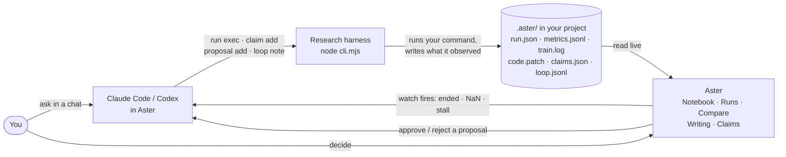
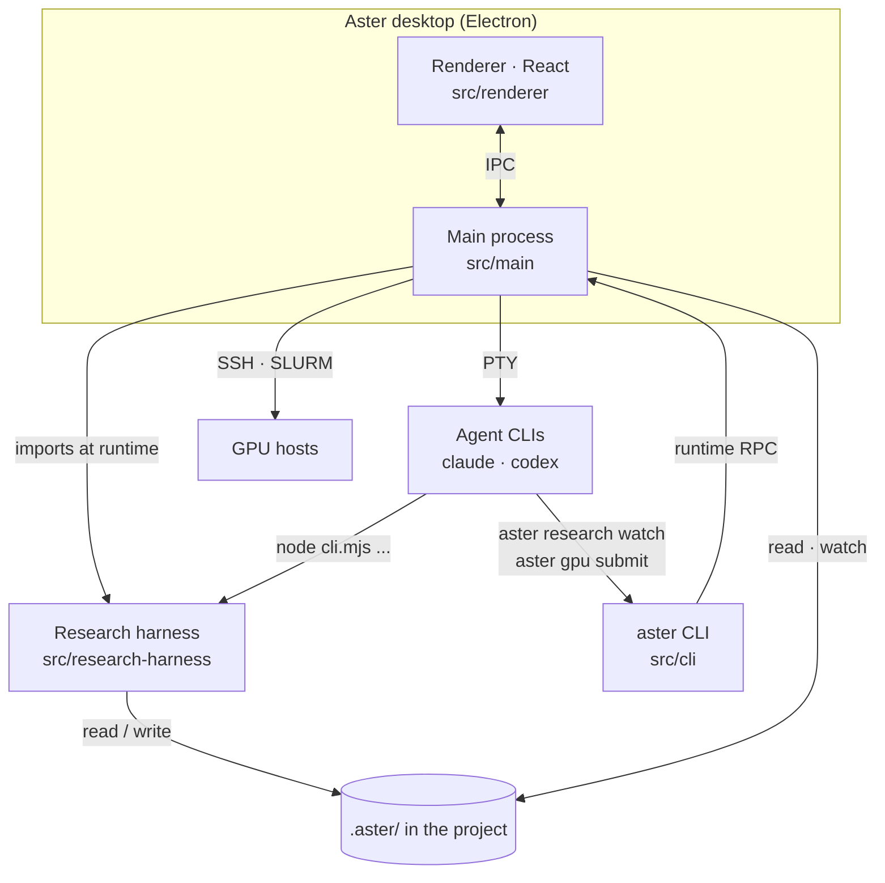

<h1 align="center">
   Aster
</h1>

<p align="center">
  <a href="https://github.com/rkdrn79/aster/releases/latest"></a>
  <a href="https://github.com/rkdrn79/aster/releases/latest"></a>
  
</p>

<p align="center">
  <sub>English · <a href="docs/readme/README.ko.md">한국어</a></sub>
</p>

<p align="center">
  <strong>The agentic development environment for AI researchers.</strong><br/>
  Run experiments with coding agents, keep the evidence of every Run, and write the paper beside it — one project, one window.
</p>

<h3 align="center">
  <a href="https://github.com/rkdrn79/aster/releases/latest">Download for macOS</a> ·
  <a href="https://rkdrn79.github.io/aster-site/">Website</a> ·
  <a href="#how-it-works">How it works</a> ·
  <a href="#try-the-demo-project">Try the demo</a>
</h3>

<p align="center">
  <picture><source media="(prefers-color-scheme: dark)" srcset="docs/assets/readme/hero-dark.jpg" /></picture>
</p>

Aster is a desktop app for research done with coding agents. A coding ADE treats the repository as
the unit of work; Aster treats the **research project** as the unit: the conversations that start
the work, the Experiments and Runs that produce results, the paper that reports them, the papers it
cites, the GPUs it runs on, and the deadline it is aiming for. Claude Code and Codex do the work in
your terminal as usual. Aster records what they actually ran and puts the evidence next to every
number they report.

- **Conversation first:** Start from a Claude Code or Codex chat. An Experiment groups the results
  afterwards; it is not a form to fill in before you can talk to an agent.
- **Evidence, not assertions:** Each Run records what actually ran, each number in the paper points
  to the Run behind it, and only you approve what runs next.
- **Your machines, your files:** No Aster account or hosted service. Agents and research records stay
  on your computer and the hosts you connect, in plain files inside the project.

## How it works



1. **Ask.** You describe the experiment in a Workbench chat or the Experiment agent pane. Aster
   attaches the project context (Runs, metrics, open findings) as a compact chip, not a wall of text.
2. **Run through the harness.** The agent launches training with
   `run exec --experiment <slug> -- python train.py ...`. The harness runs only that command and
   records the launch commit, a patch of uncommitted changes, host, argv, and agent session.
3. **Record, don't claim.** Metric lines printed by your code (`ASTER_METRIC {...}`) stream into
   `metrics.jsonl`; stdout and stderr go to `train.log`; the exit code decides the Run's state.
4. **Watch.** `aster research watch` registers what the agent is waiting for. Aster checks local Runs
   every 15 s and SSH Runs every 60 s, and wakes the agent when one fires, so nobody polls.
5. **Decide.** The agent records findings with evidence (a metric, log lines, a file) and proposes
   the next Run. The proposal shows up in the notebook's **Needs you**; you approve or reject.
6. **Write.** When a number goes into `paper/main.tex`, the agent records a claim that ties it to a
   Run's metric. Writing shows each claim as verified, stale, mismatched, or missing evidence.

Everything lives in the project as JSON, JSONL, and logs you can read, diff, and commit:

```text
my-project/
  paper/main.tex  paper/references.bib
  .aster/
    project.json                 path map of the project
    claims.json                  manuscript numbers → Run evidence
    experiments/<slug>/
      experiment.json            question, hypothesis, metric, baseline, seeds
      loop.jsonl                 research-loop ledger: hypothesis → Run → result → decision
      proposals.jsonl            next-Run proposals and your decisions
      quality.jsonl              findings with evidence
      analysis.jsonl             analyses and the Runs they used
      runs/<id>/
        run.json  metrics.jsonl  train.log  code.patch  config.json  media.jsonl  artifacts/
    library/papers/
```

See [`docs/RESEARCH_PROJECT_LAYOUT.md`](docs/RESEARCH_PROJECT_LAYOUT.md) for the full contract.

## Features

### Experiments

Every Experiment has a notebook, its Runs, and an agent beside it. Agents propose; you decide what
runs.

#### Experiment notebook

Each Experiment opens on a notebook: plan (question, metric, baseline, seeds), **Needs you** (failed
Runs, proposals, findings that wait on a decision), results with mean ± spread per configuration,
analyses, and your conclusion. The **Experiment agent** is docked beside it: ask it to design,
analyze, explain a failure, or propose the next Run.

<p align="center">
  <picture><source media="(prefers-color-scheme: dark)" srcset="docs/assets/readme/clip-experiment-analyze-dark.gif" /></picture>
</p>

#### Runs and Compare

Live metric curves, the log, config, code patch, and media for every Run. Attach existing JSONL or
CSV results, link a SLURM job, or let agents register Runs that Aster picks up on its own. Tick 2–6
Runs and **Compare** lines them up: differences from the baseline at one precision per column,
mismatched units or evaluation conditions, config differences, and outputs (text or image) matched by
sample ID. Rate samples blind, A/B, and see how your ratings agree with the agent judge.

<p align="center">
  <picture><source media="(prefers-color-scheme: dark)" srcset="docs/assets/readme/clip-notebook-runs-compare-dark.gif" /></picture>
</p>

#### Research loop

Give an agent an objective, a metric, and a budget of Runs and hours. It writes each hypothesis,
Run, result, and decision to the loop ledger, launches only through the harness, and stops for you
before going over budget or changing the evaluation.

<p align="center">
  <picture><source media="(prefers-color-scheme: dark)" srcset="docs/assets/readme/start-loop-dark.jpg" /></picture>
</p>

### Writing

The paper sits beside the Runs it reports, and every number stays tied to the Run it came from.

#### Revise with the Writing agent

TeX source, the PDF compiled with Tectonic, and a Writing agent side by side, with SyncTeX in both
directions. Select a passage in the TeX or the PDF and choose **Revise**; the agent edits only that
passage, and **Compile PDF** shows the result.

<p align="center">
  <picture><source media="(prefers-color-scheme: dark)" srcset="docs/assets/readme/clip-writing-revise-dark.gif" /></picture>
</p>

#### Claims

The **Claims** drawer checks every number in the paper against the Run it cites and marks it
verified, stale, mismatched, or missing evidence. It lists result-like numbers no Run backs, and
**Update text** fixes a mismatched number in one click.

<p align="center">
  <picture><source media="(prefers-color-scheme: dark)" srcset="docs/assets/readme/clip-writing-claims-dark.gif" /></picture>
</p>

### Library

The project's papers and PDFs with highlights and notes, arXiv and DOI import, copyable citations,
and a reading agent that summarizes a paper or relates it to your manuscript and code. Drag the
divider to give the PDF or the agent more room.

<p align="center">
  <picture><source media="(prefers-color-scheme: dark)" srcset="docs/assets/readme/clip-library-explain-dark.gif" /></picture>
</p>

<sub>The Library screenshot shows <a href="https://arxiv.org/abs/2305.08891">arXiv:2305.08891</a> by Lin et al., licensed <a href="https://creativecommons.org/licenses/by-sa/4.0/">CC BY-SA 4.0</a>.</sub>

### Compute

SSH hosts, GPUs, and SLURM queues across projects, with a GPU budget per host and project: jobs over
budget are submitted held and released in priority order. Conference deadlines from ccfddl and the
Hugging Face AI deadlines catalogs, in your time zone.

<p align="center">
  <picture><source media="(prefers-color-scheme: dark)" srcset="docs/assets/readme/home-dark.jpg" /></picture>
</p>

### Workbench

Chats, terminals, the editor, files, and Git for the project. Switching pages never stops an agent
or terminal. The **Research | Code** switch flips the sidebar to a worktree-first layout for pure
coding work.

<p align="center">
  <picture><source media="(prefers-color-scheme: dark)" srcset="docs/assets/readme/code-layout-dark.jpg" /></picture>
</p>

**Slack:** mention a project's Aster bot in an allowed channel and a coordinator agent in that project
picks up the request and answers in the thread; approvals stay in Aster. Setup is in
[`docs/readme/SLACK.md`](docs/readme/SLACK.md).

Light and dark themes in a monochrome palette, with an accent color you pick in **Settings →
Appearance**.

## Getting started

### Install

1. Download `Aster-mac-arm64.dmg` from
   [Releases](https://github.com/rkdrn79/aster/releases/latest) and drag **Aster** into
   **Applications**. Requires an Apple Silicon Mac with macOS 12 or later.
2. Builds are signed ad hoc and not notarized yet, so the first open is blocked. Right-click
   **Aster** → **Open** → **Open**, or run:

   ```bash
   xattr -dr com.apple.quarantine /Applications/Aster.app
   ```

3. Sign in to at least one agent CLI:
   [Claude Code](https://docs.anthropic.com/en/docs/claude-code) or
   [Codex](https://github.com/openai/codex). Any other CLI agent runs in a terminal tab.

Optional: [Tectonic](https://tectonic-typesetting.github.io/) on `PATH` to compile PDFs, and SSH
access to your GPU hosts (with SLURM to submit jobs). Aster keeps its data in
`~/Library/Application Support/Aster`.

### Open a research project

- **Home → Add project** and pick a folder. A project with `.aster/project.json` (or an older
  `research/project.json`) opens with its Experiments and Runs linked.
- **New project:** create an Experiment, or a manuscript in **Writing**, and Aster writes `.aster/`
  and `paper/` for you. `node $HARNESS init` does the same from a terminal. Neither overwrites
  existing files.
- **Existing project:** in the project's **…** menu choose **Organize with agent in background**.
  The `aster-research-adopt` skill surveys the folder, writes a plan, and reorganizes it on a new
  `aster/research-layout` branch. It does not merge, push, or delete; code, data, and checkpoints
  stay in place.

### Try the demo project

[`examples/research-harness-demo`](examples/research-harness-demo/README.md) is a synthetic project
that fills every page: five Experiments, a failed Run, a patch from an uncommitted edit, SLURM-linked
Runs, findings, proposals, sample ratings, a research loop, and a manuscript with verified,
mismatched, and stale claims. Add that folder as a project and open **Denoiser samples** first.

## Research harness

The harness is a zero-dependency Node CLI in [`src/research-harness/`](src/research-harness/README.md)
that agents call for every experiment. The app ships the same code as `Resources/research-harness`
and imports it at runtime, so the agent and the UI always agree on what a record means.
`aster research harness-path` prints the copy that matches the installed app.

```bash
HARNESS=$(aster research harness-path)

node $HARNESS experiment --name "LoRA r16"                 # .aster/experiments/lora-r16
node $HARNESS run exec --experiment lora-r16 --id seed-42 \
  --metric-def loss:minimize --metric-def acc:maximize:% -- python train.py --lr 3e-4

node $HARNESS claim add --text "LoRA reaches 83.0% validation accuracy" \
  --run lora-r16/seed-42 --metric acc --split val --format percent:1
node $HARNESS claim audit                                  # verified / stale / mismatch / missing-evidence
node $HARNESS verify --experiment lora-r16 --paper --json  # read-only evidence gate
node $HARNESS context                                      # compact project summary for an agent prompt
```

Print metrics and media from any language; `run exec` turns these lines into records:

```python
import json

def log_metrics(step, split, **metrics):
    print("ASTER_METRIC " + json.dumps({"step": step, "split": split, "metrics": metrics}), flush=True)

print("ASTER_MEDIA " + json.dumps({"path": "samples/step_1000.png", "step": 1000}), flush=True)
```

For a job that cannot be wrapped, register it with `new-run` and report it with `run log-metric`,
`run attach-artifact`, and `run finish`. Every command accepts `--json`; `node $HARNESS --help` lists
them all, including `preflight`, `check`, `quality`, `rate`, `proposal`, and `loop`.

The rules that keep a record honest (what `run exec` records, how claims and findings are checked,
who approves) are in [`src/research-harness/README.md`](src/research-harness/README.md).

## Aster CLI

Agents drive the app through the `aster` command (`aster-dev` for development builds).

```bash
aster research status --run lora-r16/seed-43 --json        # execution, SLURM job, metrics, log tail
aster research watch --run lora-r16/seed-43 --on failed,nan,stall:30 --on 'log:OOM|Traceback'

aster gpu status                                           # your GPU budget on each SLURM host
aster gpu submit --server my-cluster --project my-paper --workdir /scratch/me/my-paper \
  --script scripts/train.sbatch --gpus 2 --link-run lora-r16/seed-43 --dry-run
```

`--link-run` ties the job to a Run registered with `new-run`: the job's output goes to the Run's
`train.log`, and Aster writes how the job ended into its `run.json`. Worktree, terminal,
orchestration, and browser commands are listed in `aster --help`.

## Skills

Aster bundles agent skills that teach Claude Code and Codex the workflow above.

| Skill                                                                                                  | What it teaches the agent                                                                                                             |
| ------------------------------------------------------------------------------------------------------ | ------------------------------------------------------------------------------------------------------------------------------------- |
| [`aster-research-start`](src/research-harness/start/SKILL.md)                                          | Set up an Experiment's brief (question, metric, baseline, seeds) before the first Run.                                                |
| [`aster-research-track`](src/research-harness/track/SKILL.md)                                          | Read `context` first, launch every experiment with `run exec`, and record a claim right after writing a result number into the paper. |
| [`aster-research-verify`](src/research-harness/verify/SKILL.md)                                        | Trace Runs, findings, and manuscript numbers to source evidence and report what remains unverified.                                   |
| [`aster-research-loop`](src/research-harness/loop/SKILL.md)                                            | Run a budgeted hypothesis → Run → result → decision loop, with checkpoints before going over budget or changing the evaluation.       |
| [`aster-research-adopt`](src/research-harness/SKILL.md)                                                | Move an existing project into the `.aster/` layout on a branch, after showing a plan.                                                 |
| [`aster-gpu`](skills/aster-gpu/SKILL.md)                                                               | Submit SLURM jobs under the project's GPU budget, tie each job to its Run, and sleep until the Run needs attention.                   |
| [`aster-cli`](skills/aster-cli/SKILL.md), [`aster-orchestration`](skills/aster-orchestration/SKILL.md) | Drive worktrees, terminals, and the embedded browser, and coordinate several agents.                                                  |

## Status

Aster 0.1.0 is the first public release. The research flows above run on macOS and are covered by
unit tests and headless Electron tests. Known gaps:

- macOS on Apple Silicon only. Builds are signed ad hoc, not notarized, and have no update feed.
- Aster is desktop-only. For agent conversations on a phone, use the Paseo app, which runs against
  its own host.
- Windows and Linux have not been verified.
- Writing: the round trip from a selected passage through an agent's edit to a recompiled PDF has not
  been verified with a live agent. The first compile on an empty TeX cache downloads packages and can
  take minutes.
- SSH: range reads of large result files, incremental log cursors, and full log search are incomplete.
- SLURM, GPU budgets, and remote delegation have not been validated end to end on real clusters.

## Development



| Path                   | Contents                                                                |
| ---------------------- | ----------------------------------------------------------------------- |
| `src/main`             | Electron main process; research services in `src/main/research`         |
| `src/renderer`         | React UI; research pages in `src/renderer/src/features/research`        |
| `src/shared`           | Types and logic shared across processes, and the product brand          |
| `src/research-harness` | Harness CLI and the research skills (zero dependencies, plain Node ESM) |
| `src/cli`              | The `aster` CLI                                                         |
| `skills/`              | Agent skills bundled with the app                                       |
| `examples/`            | The synthetic research demo project                                     |

```bash
pnpm install --frozen-lockfile
pnpm dev                     # run the app from source
pnpm tc                      # typecheck
pnpm test                    # unit tests
pnpm lint                    # lint and repository checks
node --test src/research-harness/*.test.mjs
pnpm build:aster:mac         # local macOS package (electron-builder --dir)
```

Product identity (name, app ID, URL scheme, CLI name, copyright line, and every external link) lives
in [`src/shared/product-brand.json`](src/shared/product-brand.json); build scripts and the app read it
from there. Code conventions are in [`AGENTS.md`](AGENTS.md) and
[`.github/CONTRIBUTING.md`](.github/CONTRIBUTING.md).

## Acknowledgements

Aster is built on [Orca](https://github.com/stablyai/orca) and inspired by
[Paseo](https://github.com/getpaseo/paseo). Thank you to both projects.

## License

Aster is distributed under the [MIT License](LICENSE). Third-party licenses, including Orca's, are in
[`THIRD_PARTY_NOTICES.md`](THIRD_PARTY_NOTICES.md) and in the app under **Help → Open-Source
Licenses**.
