<h1 align="center">
   Aster
</h1>

<p align="center">
  <a href="https://github.com/rkdrn79/aster/releases/latest"></a>
  <a href="https://github.com/rkdrn79/aster/releases/latest"></a>
  
</p>

<p align="center">
  <sub><a href="../../README.md">English</a> · 한국어</sub>
</p>

<p align="center">
  <strong>AI 연구자를 위한 에이전트 개발 환경(ADE).</strong><br/>
  코딩 에이전트로 실험을 돌리고, 모든 Run의 근거를 남기고, 그 옆에서 논문을 씁니다. 하나의 프로젝트, 하나의 창에서.
</p>

<h3 align="center">
  <a href="https://github.com/rkdrn79/aster/releases/latest">macOS용 다운로드</a> ·
  <a href="https://rkdrn79.github.io/aster-site/">웹사이트</a> ·
  <a href="#작동-방식">작동 방식</a> ·
  <a href="#데모-프로젝트-열어보기">데모 열어보기</a>
</h3>

<p align="center">
  <picture><source media="(prefers-color-scheme: dark)" srcset="../assets/readme/hero-dark.jpg" />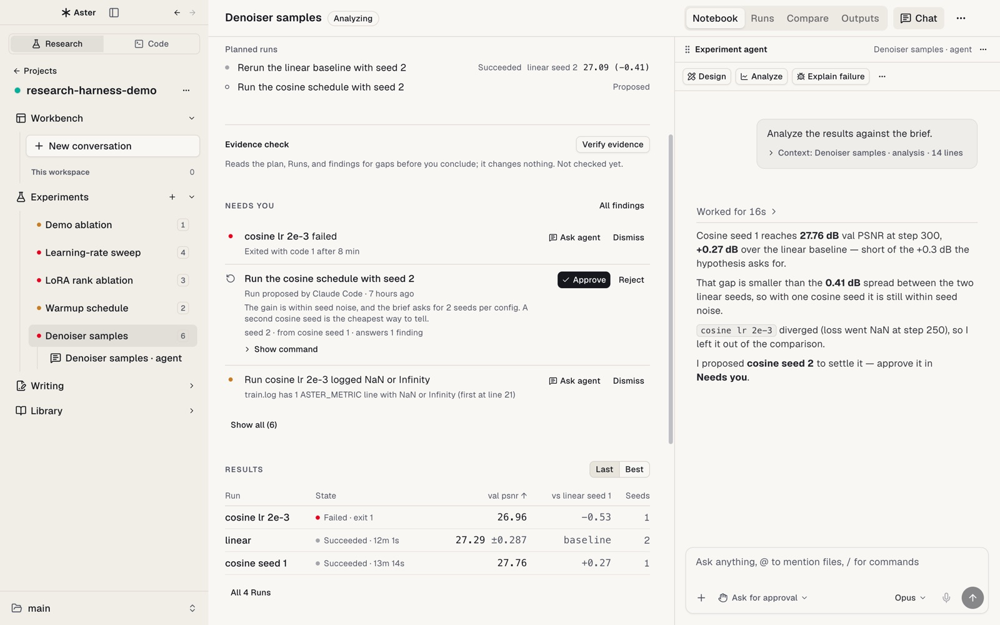</picture>
</p>

Aster는 코딩 에이전트와 함께 연구하기 위한 데스크톱 앱입니다. 코딩용 ADE가 저장소를 작업 단위로
삼는다면, Aster는 **연구 프로젝트**를 작업 단위로 삼습니다. 작업을 시작하는 대화, 결과를 만드는
Experiment와 Run, 그 결과를 보고하는 논문, 논문이 인용하는 문헌, 실험을 돌리는 GPU, 목표로 하는
마감일까지 한 곳에 둡니다. Claude Code와 Codex는 평소처럼 터미널에서 일하고, Aster는 에이전트가
실제로 무엇을 실행했는지 기록해 에이전트가 보고하는 모든 수치 옆에 근거를 붙여 둡니다.

- **대화에서 시작:** Claude Code나 Codex 채팅으로 바로 시작합니다. Experiment는 나중에 결과를 묶는
  단위이며, 에이전트와 대화하기 전에 채워야 하는 양식이 아닙니다.
- **주장이 아니라 근거:** Run은 실제로 실행된 것을 기록하고, 논문의 수치는 그 근거가 된 Run을
  가리키며, 다음에 무엇을 실행할지는 사용자만 승인합니다.
- **내 컴퓨터, 내 파일:** Aster 계정이나 호스팅 서비스가 없습니다. 에이전트와 연구 기록은 내
  컴퓨터와 연결한 호스트의 프로젝트 폴더 안에 일반 파일로 남습니다.

## 작동 방식

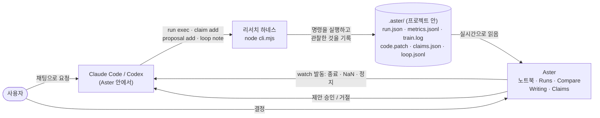

1. **요청.** Workbench 채팅이나 Experiment 에이전트 창에 실험을 설명합니다. Aster는 프로젝트
   맥락(Run, 지표, 열린 finding)을 긴 텍스트 대신 작은 칩으로 붙여 보냅니다.
2. **하네스로 실행.** 에이전트는 `run exec --experiment <slug> -- python train.py ...`로 학습을
   띄웁니다. 하네스는 그 명령만 실행하고, 실행 시점의 커밋, 커밋되지 않은 변경의 patch, 호스트,
   argv, 에이전트 세션을 기록합니다.
3. **주장하지 않고 기록.** 코드가 출력한 지표 줄(`ASTER_METRIC {...}`)은 `metrics.jsonl`로, stdout과
   stderr는 `train.log`로 들어가고, Run의 상태는 종료 코드가 정합니다.
4. **watch.** `aster research watch`로 에이전트가 기다리는 조건을 등록합니다. Aster가 로컬 Run은
   15초, SSH Run은 60초마다 확인하고 조건이 맞으면 에이전트를 깨우므로 아무도 폴링하지 않습니다.
5. **결정.** 에이전트는 근거(지표, 로그 줄, 파일)와 함께 finding을 기록하고 다음 Run을 제안합니다.
   제안은 노트북의 **Needs you**에 나타나고, 사용자가 승인하거나 거절합니다.
6. **작성.** 수치를 `paper/main.tex`에 쓰면 에이전트가 그 수치를 Run의 지표에 묶는 claim을
   기록합니다. Writing은 claim마다 verified, stale, mismatch, missing evidence를 표시합니다.

모든 기록은 읽고, diff하고, 커밋할 수 있는 JSON, JSONL, 로그로 프로젝트 안에 남습니다.

```text
my-project/
  paper/main.tex  paper/references.bib
  .aster/
    project.json                 프로젝트 경로 맵
    claims.json                  원고 수치 → Run 근거
    experiments/<slug>/
      experiment.json            질문, 가설, 지표, baseline, seed
      loop.jsonl                 연구 루프 기록: 가설 → Run → 결과 → 결정
      proposals.jsonl            다음 Run 제안과 사용자의 결정
      quality.jsonl              근거가 붙은 finding
      analysis.jsonl             분석과 분석에 쓴 Run
      runs/<id>/
        run.json  metrics.jsonl  train.log  code.patch  config.json  media.jsonl  artifacts/
    library/papers/
```

전체 규약은 [`docs/RESEARCH_PROJECT_LAYOUT.md`](../RESEARCH_PROJECT_LAYOUT.md)에 있습니다.

## 기능

### 실험 (Experiments)

Experiment마다 노트북, Run, 옆에 붙은 에이전트가 있습니다. 에이전트는 제안하고, 무엇을 실행할지는
사용자가 정합니다.

#### Experiment 노트북

Experiment를 열면 노트북이 나옵니다. 계획(질문, 지표, baseline, seed), **Needs you**(결정을 기다리는
실패한 Run, 제안, finding), 설정별 평균 ± 편차로 정리된 결과, 분석, 사용자가 쓰는 결론. 옆에 붙은
**Experiment 에이전트**에게 설계, 분석, 실패 원인 설명, 다음 Run 제안을 맡깁니다.

<p align="center">
  <picture><source media="(prefers-color-scheme: dark)" srcset="../assets/readme/clip-experiment-analyze-dark.gif" />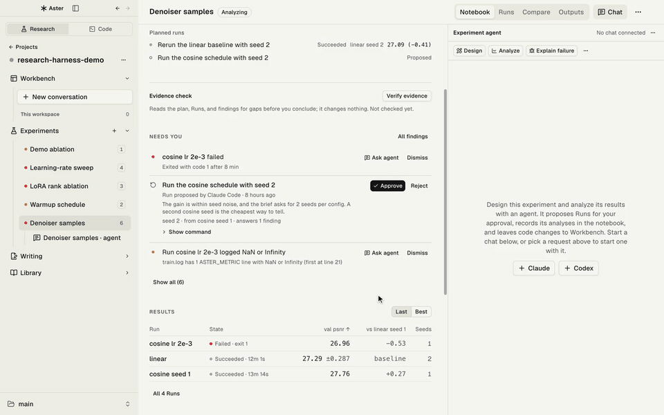</picture>
</p>

#### Runs와 Compare

Run마다 실시간 지표 곡선, 로그, config, 코드 patch, 미디어를 봅니다. 기존 JSONL·CSV 결과를 붙이거나,
SLURM 작업을 연결하거나, 에이전트가 등록한 Run을 Aster가 알아서 가져옵니다. Run 2–6개를 고르면
**Compare**가 나란히 보여줍니다. 열마다 같은 정밀도로 baseline과의 차이, 단위나 평가 조건 불일치,
config 차이, 샘플 ID로 맞춘 출력(텍스트·이미지)을 보고, 샘플을 블라인드 A/B로 평가해 에이전트 judge와
얼마나 일치하는지 확인합니다.

<p align="center">
  <picture><source media="(prefers-color-scheme: dark)" srcset="../assets/readme/clip-notebook-runs-compare-dark.gif" />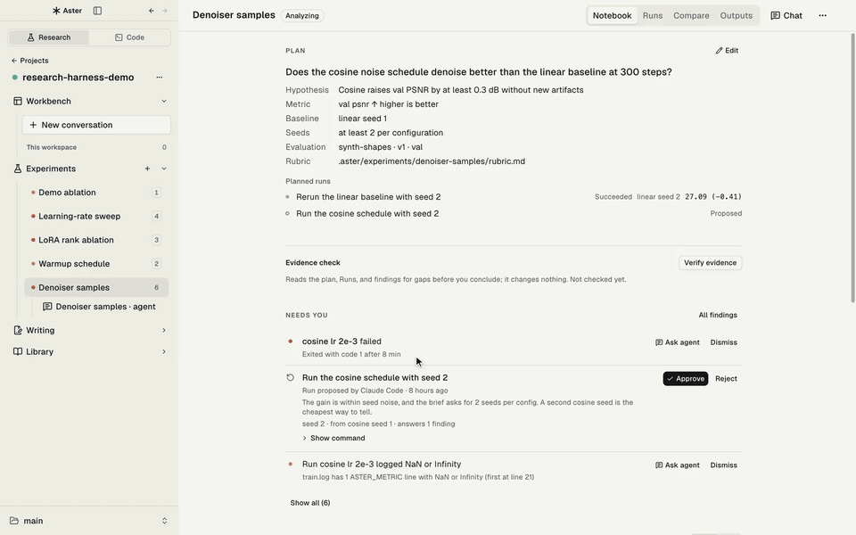</picture>
</p>

#### 연구 루프

에이전트에게 목표, 지표, Run 수와 시간 예산을 줍니다. 에이전트는 가설, Run, 결과, 결정을 루프
기록에 남기고, 하네스로만 실행하며, 예산을 넘기거나 평가 방식을 바꾸기 전에 멈춰서 사용자에게
묻습니다.

<p align="center">
  <picture><source media="(prefers-color-scheme: dark)" srcset="../assets/readme/start-loop-dark.jpg" />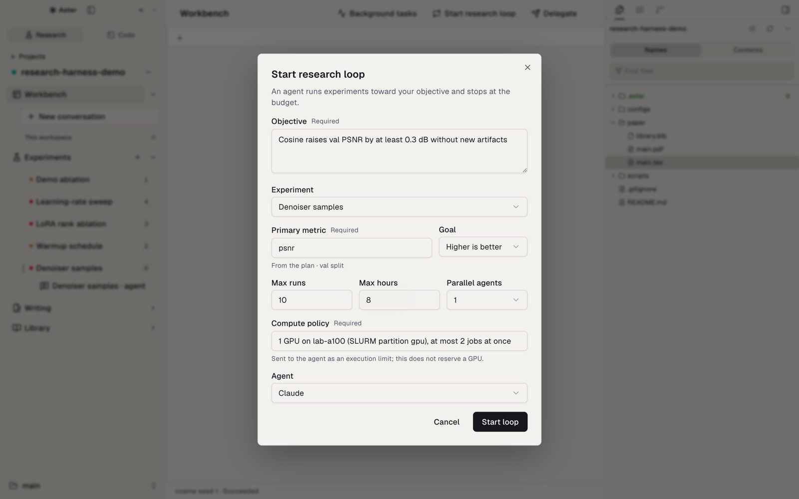</picture>
</p>

### 논문 (Writing)

논문은 그 논문이 보고하는 Run 바로 옆에 있고, 모든 수치는 출처가 된 Run에 묶여 있습니다.

#### Writing 에이전트로 수정하기

TeX 소스, Tectonic으로 컴파일한 PDF, Writing 에이전트를 나란히 두고 SyncTeX로 양방향 이동합니다.
TeX나 PDF에서 문단을 선택해 **Revise**를 고르면 에이전트가 그 문단만 고치고, **Compile PDF**로 결과를
확인합니다.

<p align="center">
  <picture><source media="(prefers-color-scheme: dark)" srcset="../assets/readme/clip-writing-revise-dark.gif" />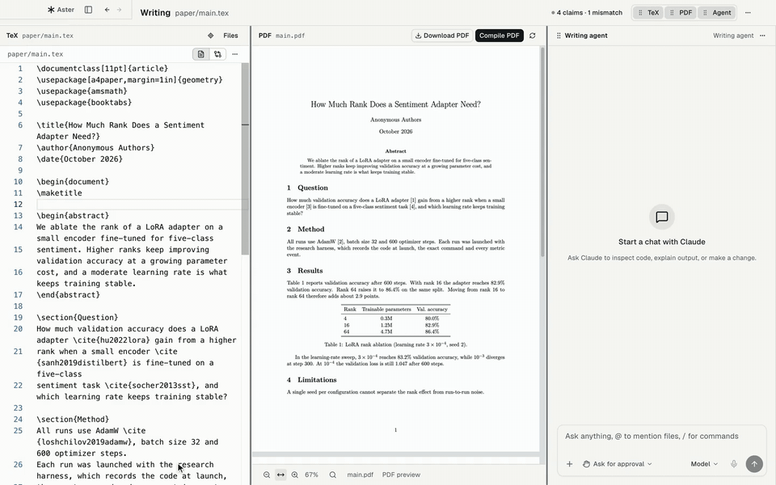</picture>
</p>

#### Claims

**Claims** 서랍은 논문의 모든 수치를 그 수치가 가리키는 Run과 대조해 verified, stale, mismatch,
missing evidence로 표시합니다. Run이 뒷받침하지 않는 결과 수치를 찾아내고, **Update text**로 어긋난
수치를 한 번에 고칩니다.

<p align="center">
  <picture><source media="(prefers-color-scheme: dark)" srcset="../assets/readme/clip-writing-claims-dark.gif" />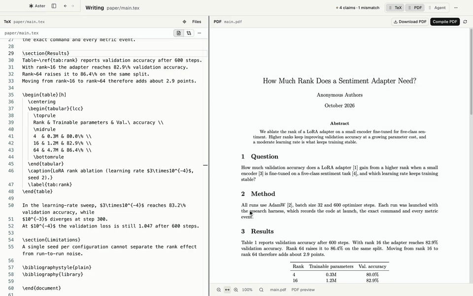</picture>
</p>

### 문헌 (Library)

프로젝트의 논문과 PDF를 하이라이트·메모와 함께 관리하고, arXiv·DOI로 가져오고, 인용을 복사합니다.
읽기 에이전트가 논문을 요약하거나 내 원고·코드와 연결합니다. 가운데 구분선을 끌어 PDF와 에이전트
창 크기를 조절합니다.

<p align="center">
  <picture><source media="(prefers-color-scheme: dark)" srcset="../assets/readme/clip-library-explain-dark.gif" />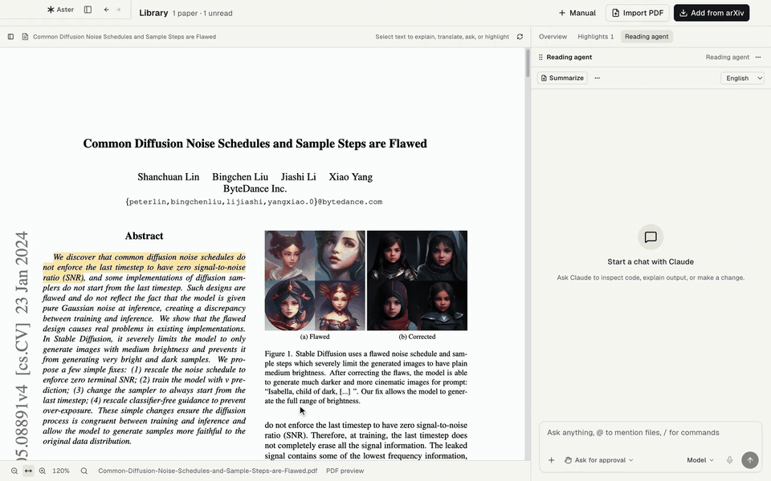</picture>
</p>

<sub>Library 스크린샷의 논문은 Lin et al.의 <a href="https://arxiv.org/abs/2305.08891">arXiv:2305.08891</a>이며 <a href="https://creativecommons.org/licenses/by-sa/4.0/">CC BY-SA 4.0</a>으로 배포됩니다.</sub>

### 기타 (Others)

프로젝트 전반의 GPU와 마감일, 코딩 작업 공간, 에이전트가 쓰는 CLI입니다.

#### Compute와 마감일

여러 프로젝트에 걸친 SSH 호스트, GPU, SLURM 큐를 보고, 호스트·프로젝트별 GPU 예산을 정합니다. 예산을
넘는 작업은 hold 상태로 제출됐다가 우선순위대로 풀립니다. ccfddl과 Hugging Face AI deadlines의 학회
마감일을 내 시간대로 보여줍니다.

<p align="center">
  <picture><source media="(prefers-color-scheme: dark)" srcset="../assets/readme/home-dark.jpg" />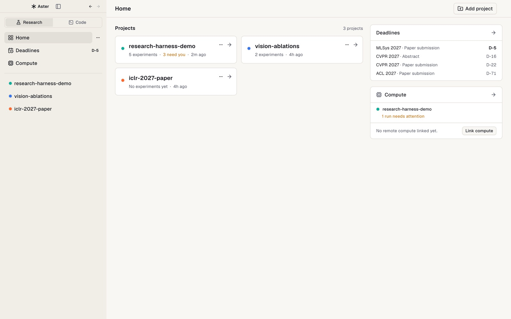</picture>
</p>

#### Workbench와 Code 레이아웃

프로젝트의 채팅, 터미널, 에디터, 파일, Git. 페이지를 옮겨도 에이전트나 터미널은 멈추지 않습니다.
**Research | Code** 전환으로 순수 코딩 작업용 worktree 중심 레이아웃으로 바꿀 수 있습니다.

<p align="center">
  <picture><source media="(prefers-color-scheme: dark)" srcset="../assets/readme/code-layout-dark.jpg" />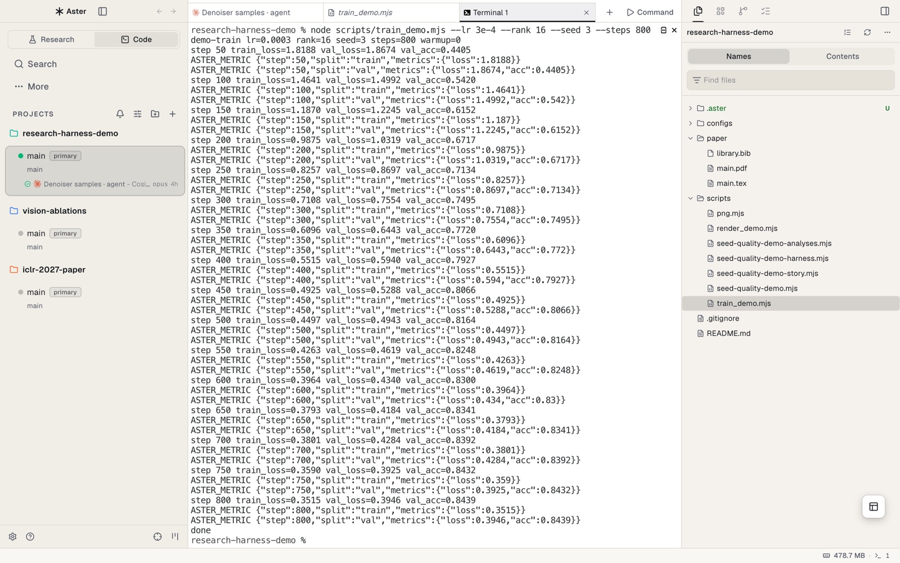</picture>
</p>

#### 리서치 하네스

실험마다 쓰는 작은 CLI입니다. 에이전트는 이것으로 Run을 띄우고 claim을 기록하고, 앱도 같은 코드를
불러오므로 에이전트와 화면이 기록을 똑같이 해석합니다. 명령은 [리서치 하네스](#리서치-하네스)에 있습니다.

**Slack:** 허용한 채널에서 프로젝트의 Aster 봇을 멘션하면 그 프로젝트의 코디네이터 에이전트가 요청을 받아
스레드에 답합니다. 승인은 Aster 안에서만 합니다. 설정 방법은 [Slack 연결 안내](SLACK.ko.md)에 있습니다.

흑백 팔레트의 라이트·다크 테마를 쓰고, 강조색은 **설정 → Appearance**에서 고릅니다.

## 시작하기

### 설치

1. [Releases](https://github.com/rkdrn79/aster/releases/latest)에서
   `Aster-mac-arm64.dmg`를 받아 **Aster**를 **응용 프로그램**으로 끌어 놓습니다. Apple
   Silicon Mac, macOS 12 이상이 필요합니다.
2. 빌드는 ad hoc 서명만 되어 있고 아직 공증(notarize)되지 않아 처음 열 때 막힙니다. **Aster**를
   오른쪽 클릭 → **열기** → **열기**를 누르거나 다음을 실행합니다.

   ```bash
   xattr -dr com.apple.quarantine /Applications/Aster.app
   ```

3. 에이전트 CLI 하나 이상에 로그인합니다:
   [Claude Code](https://docs.anthropic.com/en/docs/claude-code) 또는
   [Codex](https://github.com/openai/codex). 다른 CLI 에이전트는 터미널 탭에서 실행됩니다.

선택 사항: PDF 컴파일용 [Tectonic](https://tectonic-typesetting.github.io/)을 `PATH`에 두고, GPU
호스트에 SSH로 접속할 수 있게 합니다(작업 제출에는 SLURM 필요). Aster의 데이터는
`~/Library/Application Support/Aster`에 저장됩니다.

### 연구 프로젝트 열기

- **홈 → Add project**에서 폴더를 고릅니다. `.aster/project.json`(또는 예전
  `research/project.json`)이 있는 프로젝트는 Experiment와 Run이 연결된 채로 열립니다.
- **새 프로젝트:** Experiment를 만들거나 **Writing**에서 원고를 만들면 Aster가 `.aster/`와 `paper/`를
  만듭니다. 터미널에서는 `node $HARNESS init`이 같은 일을 합니다. 어느 쪽도 기존 파일을 덮어쓰지
  않습니다.
- **기존 프로젝트:** 프로젝트의 **…** 메뉴에서 **Organize with agent in background**를 고릅니다.
  `aster-research-adopt` 스킬이 폴더를 살펴보고 계획을 쓴 뒤 새 `aster/research-layout` 브랜치에서
  정리합니다. merge, push, 삭제는 하지 않고 코드, 데이터, 체크포인트는 그대로 둡니다.

### 데모 프로젝트 열어보기

[`examples/research-harness-demo`](../../examples/research-harness-demo/README.md)는 모든 화면을
채우는 합성 프로젝트입니다. Experiment 다섯 개, 실패한 Run, 커밋되지 않은 변경에서 나온 patch,
SLURM에 연결된 Run, finding, 제안, 샘플 평가, 연구 루프, verified·mismatch·stale claim이 있는 원고가
들어 있습니다. 이 폴더를 프로젝트로 추가하고 **Denoiser samples**부터 열어 보세요.

## 리서치 하네스

하네스는 [`src/research-harness/`](../../src/research-harness/README.md)에 있는 의존성 없는 Node
CLI이며, 에이전트가 모든 실험에서 호출합니다. 앱도 같은 코드를 `Resources/research-harness`로 담아
실행 중에 불러오므로 에이전트와 UI가 기록을 똑같이 해석합니다. `aster research harness-path`는 설치된
앱과 버전이 맞는 사본의 경로를 출력합니다.

```bash
HARNESS=$(aster research harness-path)

node $HARNESS experiment --name "LoRA r16"                 # .aster/experiments/lora-r16
node $HARNESS run exec --experiment lora-r16 --id seed-42 \
  --metric-def loss:minimize --metric-def acc:maximize:% -- python train.py --lr 3e-4

node $HARNESS claim add --text "LoRA reaches 83.0% validation accuracy" \
  --run lora-r16/seed-42 --metric acc --split val --format percent:1
node $HARNESS claim audit                                  # verified / stale / mismatch / missing-evidence
node $HARNESS verify --experiment lora-r16 --paper --json  # 읽기 전용 근거 점검
node $HARNESS context                                      # 에이전트 프롬프트용 프로젝트 요약
```

지표와 미디어는 어떤 언어에서든 출력하면 됩니다. `run exec`가 이 줄을 기록으로 바꿉니다.

```python
import json

def log_metrics(step, split, **metrics):
    print("ASTER_METRIC " + json.dumps({"step": step, "split": split, "metrics": metrics}), flush=True)

print("ASTER_MEDIA " + json.dumps({"path": "samples/step_1000.png", "step": 1000}), flush=True)
```

감쌀 수 없는 작업은 `new-run`으로 등록하고 `run log-metric`, `run attach-artifact`, `run finish`로
보고합니다. 모든 명령은 `--json`을 받으며, `node $HARNESS --help`에 `preflight`, `check`, `quality`,
`rate`, `proposal`, `loop`까지 전체 목록이 있습니다.

기록을 믿을 수 있게 하는 규칙(`run exec`가 무엇을 기록하는지, claim과 finding을 어떻게 검사하는지,
누가 승인하는지)은 [`src/research-harness/README.md`](../../src/research-harness/README.md)에 있습니다.

## Aster CLI

에이전트는 `aster` 명령(개발 빌드는 `aster-dev`)으로 앱을 다룹니다.

```bash
aster research status --run lora-r16/seed-43 --json        # 실행 상태, SLURM 작업, 지표, 로그 끝부분
aster research watch --run lora-r16/seed-43 --on failed,nan,stall:30 --on 'log:OOM|Traceback'

aster gpu status                                           # SLURM 호스트별 내 GPU 예산
aster gpu submit --server my-cluster --project my-paper --workdir /scratch/me/my-paper \
  --script scripts/train.sbatch --gpus 2 --link-run lora-r16/seed-43 --dry-run
```

`--link-run`은 작업을 `new-run`으로 등록한 Run에 묶습니다. 작업 출력은 Run의 `train.log`로 들어가고,
작업이 어떻게 끝났는지 Aster가 `run.json`에 씁니다. worktree, 터미널, 오케스트레이션, 브라우저 명령은
`aster --help`에 있습니다.

## 스킬

Aster는 위 작업 흐름을 Claude Code와 Codex에 가르치는 에이전트 스킬을 함께 제공합니다.

| 스킬                                                                                                               | 에이전트에게 가르치는 것                                                                              |
| ------------------------------------------------------------------------------------------------------------------ | ----------------------------------------------------------------------------------------------------- |
| [`aster-research-start`](../../src/research-harness/start/SKILL.md)                                                | 첫 Run 전에 Experiment의 brief(질문, 지표, baseline, seed)를 정합니다.                                |
| [`aster-research-track`](../../src/research-harness/track/SKILL.md)                                                | `context`를 먼저 읽고, 모든 실험을 `run exec`로 띄우고, 원고에 수치를 쓰면 바로 claim을 기록합니다.   |
| [`aster-research-verify`](../../src/research-harness/verify/SKILL.md)                                              | Run, finding, 원고 수치를 근거까지 추적하고 아직 검증되지 않은 것을 보고합니다.                       |
| [`aster-research-loop`](../../src/research-harness/loop/SKILL.md)                                                  | 예산 안에서 가설 → Run → 결과 → 결정 루프를 돌리고, 예산 초과나 평가 변경 전에는 멈춥니다.            |
| [`aster-research-adopt`](../../src/research-harness/SKILL.md)                                                      | 계획을 보여준 뒤 기존 프로젝트를 브랜치에서 `.aster/` 구조로 옮깁니다.                                |
| [`aster-gpu`](../../skills/aster-gpu/SKILL.md)                                                                     | 프로젝트 GPU 예산 안에서 SLURM 작업을 제출하고, 작업을 Run에 묶고, Run에 일이 생길 때까지 기다립니다. |
| [`aster-cli`](../../skills/aster-cli/SKILL.md), [`aster-orchestration`](../../skills/aster-orchestration/SKILL.md) | worktree, 터미널, 내장 브라우저를 다루고 여러 에이전트를 조율합니다.                                  |

## 상태

Aster 1.0.0은 기능을 통합한 첫 데스크톱 릴리스 목표입니다. 위 연구 흐름은 단위 테스트와 headless
Electron 테스트로 확인했습니다. 아직 남은 부분은 다음과 같습니다.

- Apple Silicon macOS 빌드는 ad hoc 서명만 되어 있고 공증되지 않았습니다. 새 릴리스 알림은
  제공하지만 앱 교체는 다운로드 후 직접 해야 합니다. Windows x64는 CI에서 빌드·연구 E2E·설치
  파일과 ZIP 스모크 테스트를 통과한 공개 미리보기이며, 코드 서명은 아직 없습니다.
- Aster는 데스크톱 전용입니다. 휴대폰에서 에이전트와 대화하려면 자체 호스트에서 동작하는 Paseo 앱을
  쓰세요.
- Windows의 실제 사용자 PC 설치·연구 작업과 Linux 데스크톱은 아직 검증하지 않았습니다.
- Writing: 선택한 문단 → 에이전트 수정 → PDF 재컴파일 왕복은 실제 에이전트로 검증하지 않았습니다.
  TeX 캐시가 비어 있으면 첫 컴파일 때 패키지를 내려받느라 몇 분 걸릴 수 있습니다.
- SSH: 큰 결과 파일의 범위 읽기, 로그 증분 커서, 전체 로그 검색이 완성되지 않았습니다.
- SLURM, GPU 예산, 원격 위임은 실제 클러스터에서 처음부터 끝까지 검증하지 않았습니다.

## 개발

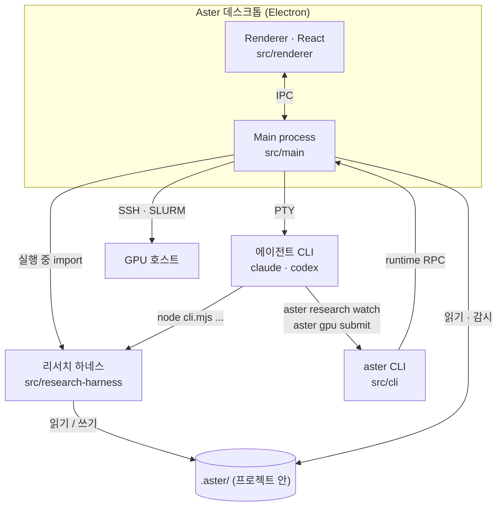

| 경로                   | 내용                                                       |
| ---------------------- | ---------------------------------------------------------- |
| `src/main`             | Electron main process, 연구 서비스는 `src/main/research`   |
| `src/renderer`         | React UI, 연구 화면은 `src/renderer/src/features/research` |
| `src/shared`           | 프로세스 간 공유 타입과 로직, 제품 브랜드                  |
| `src/research-harness` | 하네스 CLI와 연구 스킬(의존성 없는 Node ESM)               |
| `src/cli`              | `aster` CLI                                                |
| `skills/`              | 앱과 함께 제공되는 에이전트 스킬                           |
| `examples/`            | 합성 연구 데모 프로젝트                                    |

```bash
pnpm install --frozen-lockfile
pnpm dev                     # 소스에서 앱 실행
pnpm tc                      # 타입 검사
pnpm test                    # 단위 테스트
pnpm lint                    # lint와 저장소 점검
node --test src/research-harness/*.test.mjs
pnpm build:aster:mac         # 로컬 macOS 패키지(electron-builder --dir)
```

제품 식별 정보(이름, 앱 ID, URL scheme, CLI 이름, 저작권 문구, 모든 외부 링크)는
[`src/shared/product-brand.json`](../../src/shared/product-brand.json)에 있고, 빌드 스크립트와 앱이
여기서 읽습니다. 코드 규칙은 [`AGENTS.md`](../../AGENTS.md)와
[`.github/CONTRIBUTING.md`](../../.github/CONTRIBUTING.md)에 있습니다.

## 감사의 말

Aster는 [Orca](https://github.com/stablyai/orca)를 바탕으로 만들었고 [Paseo](https://github.com/getpaseo/paseo)에서
영감을 받았습니다. 두 프로젝트에 감사드립니다.

## 라이선스

Aster는 [MIT License](../../LICENSE)로 배포됩니다. Orca를 포함한 서드파티 라이선스는
[`THIRD_PARTY_NOTICES.md`](../../THIRD_PARTY_NOTICES.md)와 앱의 **Help → Open-Source Licenses**에서
볼 수 있습니다.
