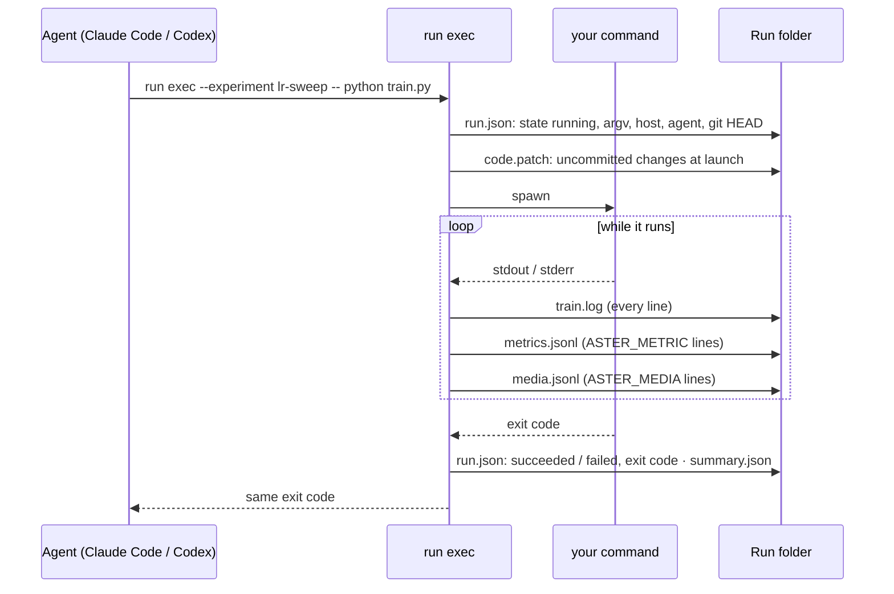

# Research harness

The command-line core of Aster's research record. Agents call it for every experiment, and the
desktop app imports the same modules at runtime (`src/main/research`), so the agent and the UI read
and write records with one implementation. It is plain Node ESM with no dependencies; the packaged
app ships this folder as `Resources/research-harness`, and `aster research harness-path` prints it.

```bash
node src/research-harness/cli.mjs --help
node src/research-harness/cli.mjs context --project examples/research-harness-demo
```

## A Run, end to end



The exit code is the only thing that decides whether a Run succeeded. A metric line with `NaN`, a
path outside the project, or an oversized line is dropped with a notice instead of being recorded.

## Rules the records follow

- **Observed, not asserted.** `run exec` runs only the command it is given and records what it saw.
  A claim reads its value from `metrics.jsonl`; a `--value` that disagrees is refused.
- **Evidence is checked.** An agent finding (`quality add`) must cite a metric, log lines, a file, a
  manifest field, a sample, or a claim, and each item is checked against the Run's files.
- **The user decides.** Approving or rejecting a proposal, and accepting or dismissing a finding,
  are refused inside a Claude Code or Codex session, detected from its environment. Agents
  propose, launch what was approved, and resolve their own findings with a note naming the re-run.
- **Gates are not proof.** `verify` and `preflight` are read-only. `checks_clear` means the
  automated checks found no open issue, not that the result is scientifically valid.
- **Safe writes.** JSON is written atomically, JSONL ledgers are append-only under a file lock, IDs
  and slugs are validated, and symlinked or escaping paths are refused.

## Modules

| Area                   | Modules                                                                                                                                                             |
| ---------------------- | ------------------------------------------------------------------------------------------------------------------------------------------------------------------- |
| Entry point            | `cli.mjs`, `research-cli-arguments.mjs`, `research-cli-text-output.mjs`                                                                                             |
| Project layout         | `research-layout.mjs` (`.aster/` and the legacy `research/` tree), `research-project.mjs` (init, Experiments, Runs), `research-catalog.mjs`, `research-migrate.mjs` |
| Launching Runs         | `research-run-exec.mjs`, `research-code-capture.mjs`, `research-agent-identity.mjs`, `research-metric-events.mjs`, `research-run-log-facts.mjs`                     |
| Run records            | `research-run-manifest.mjs`, `research-run-updates.mjs`, `research-run-summary.mjs`, `research-run-media.mjs`, `research-run-outputs.mjs`, `research-run-notes.mjs` |
| Claims and manuscript  | `research-claims.mjs`, `research-manuscript-numbers.mjs`                                                                                                            |
| Experiment brief       | `research-experiment-brief.mjs`, `research-brief-cli.mjs`, `research-run-conditions.mjs`                                                                            |
| Checks and gates       | `research-checks.mjs`, `research-preflight.mjs`, `research-validation.mjs`, `research-verification.mjs`                                                             |
| Findings and ratings   | `research-quality-ledger.mjs`, `research-quality-evidence.mjs`, `research-quality-cli.mjs`, `research-ratings.mjs`, `research-ratings-cli.mjs`                      |
| Proposals and analyses | `research-proposals.mjs`, `research-proposal-cli.mjs`, `research-analysis.mjs`, `research-analysis-cli.mjs`                                                         |
| Loop and agent context | `research-loop-ledger.mjs`, `research-jsonl-ledger.mjs`, `research-project-context.mjs`                                                                             |
| Storage                | `research-file-transactions.mjs` (atomic writes, file locks, hashes), `research-harness-error.mjs`                                                                  |
| Existing projects      | `research-organize-cli.mjs`                                                                                                                                         |

## Skills

The skills in this folder teach agents when and how to call the harness. The app bundles them;
`config/scripts/install-aster-research-skill.sh` links a source checkout's copies into
`~/.agents/skills` and `~/.claude/skills`.

| Skill                          | Use                                                                |
| ------------------------------ | ------------------------------------------------------------------ |
| [`start/`](start/SKILL.md)     | Set up a new project and its first Experiment.                     |
| [`track/`](track/SKILL.md)     | Keep Experiments, Runs, analyses, and paper numbers traceable.     |
| [`loop/`](loop/SKILL.md)       | Run a budgeted hypothesis → Run → result → decision loop.          |
| [`verify/`](verify/SKILL.md)   | Trace results to evidence and report what remains unverified.      |
| [`SKILL.md`](SKILL.md) (adopt) | Reorganize an existing research folder into `.aster/` on a branch. |

## Tests

```bash
node --test src/research-harness/*.test.mjs
```

The record contract is described in
[`docs/RESEARCH_PROJECT_LAYOUT.md`](../../docs/RESEARCH_PROJECT_LAYOUT.md).
